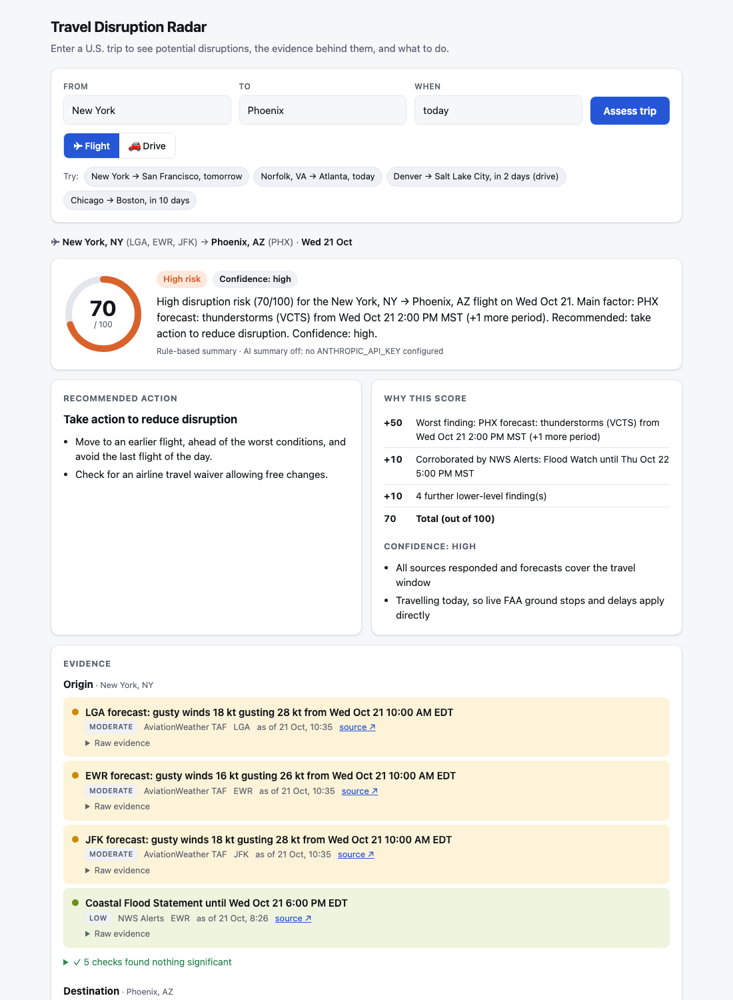

# Travel Disruption Radar

A prototype for checking whether a U.S. trip is likely to be disrupted. You
enter a route and a date (e.g. New York → San Francisco, tomorrow), by air or
by road, and it pulls together live data from several public sources and
gives you a risk score, the evidence behind it, and a suggested action.



## Running it

You need Python 3.10 or newer. macOS's built-in Python 3.9 won't work: its
old SSL library can't connect to the routing service. I used Python 3.13.

```bash
python3.13 -m venv .venv && source .venv/bin/activate
pip install -r requirements.txt
cp .env.example .env          # ANTHROPIC_API_KEY is optional, see below
uvicorn app.main:app --reload
```

Then open http://127.0.0.1:8000. The buttons under the form run a few
example trips.

Tests: `python -m pytest -q`

## What it does

For a flight, it checks the main airports at both ends (New York → LGA, EWR
and JFK). For a drive, it gets the road route and checks points every
~150 km along it, using the time you'd actually reach each point.

It then asks four sources, in parallel:

| Source | What I use it for | Mode |
|---|---|---|
| FAA NAS Status (`nasstatus.faa.gov`) | Ground stops, ground delay programs, delays, closures | Flight |
| AviationWeather.gov TAF | Airport forecasts: low cloud, visibility, wind, storms | Flight |
| NWS `api.weather.gov` alerts | Official warnings and advisories | Both |
| Open-Meteo forecast | Hourly forecast up to 16 days out | Both |

Plus three for working out where things are: Open-Meteo geocoding (city name
to coordinates), the OurAirports dataset (city to airports) and OSRM
(driving routes). All of them are free and none need an API key.

The result is a score out of 100 with a level (Minimal / Low / Moderate /
High / Severe), a confidence rating, a recommended action, a short summary,
and every piece of evidence with a link back to where it came from.

## How it's put together

```
input → resolve places/airports/date → sources (in parallel) → signals
      → risk rules (score, confidence, action) → summary
```

| Path | |
|---|---|
| `app/main.py` | FastAPI app. `POST /api/assess`, plus `GET /api/resolve` and `GET /api/signals` for debugging |
| `app/resolve.py`, `geo.py`, `dates.py`, `route.py` | Turning text input into places, airports, a date and a route |
| `app/connectors/` | One file per source: `faa`, `taf`, `nws`, `openmeteo` |
| `app/timewin.py` | Works out when the traveller is actually exposed |
| `app/risk.py` | Scoring, confidence and the recommended action |
| `app/summary.py` | The Claude summary and the checks on it |
| `app/models.py` | Shared data types |
| `static/index.html` | The UI: one page, plain JavaScript |
| `data/airports_us.csv` | U.S. airports with scheduled service, built by `scripts/build_airports.py` |
| `tests/` | 53 tests |

Every source returns its findings in the same format (a `Signal`: source,
place, severity, headline, raw evidence, link, time). That keeps the scoring
and the UI independent of any particular source, and adding a new one means
adding one file.

## Decisions and why

### Input

- **Airports.** I bundled a filtered copy of the OurAirports data (502 U.S.
  airports with scheduled passenger service) instead of calling an API for
  this. A city maps to the major airports within 100 km. If a city has none,
  it falls back to smaller ones. Without that rule, Chicago listed Gary,
  Indiana. Typing an airport code (`SFO`) checks just that airport.
- **Ambiguous names.** An exact name match wins, then the largest
  population. "Portland" gives Portland, OR, and "Portland, ME" overrides
  that. The page always shows what it understood, so a wrong guess is easy
  to spot. Before I added the exact-match rule, "Aspen" became Aspen Hill, MD.
- **Dates.** A small parser for what people actually type: "tomorrow",
  "friday", "next friday", "10/24", or an ISO date. "Today" and "tomorrow"
  are worked out in the origin's timezone, not the server's. Anything more
  than 16 days away is rejected, because the forecasts stop there and a
  score would look more certain than it is.

### Sources

- All sources run at the same time (1-2 s in total) with a 20 s limit each.
  If one fails, the result says so and confidence goes down. A source that
  failed should never look like "no risk found". Each call is retried once
  if the connection drops or the server returns a 5xx. I saw Open-Meteo do
  this during testing.
- When a source checks something and finds nothing, that's recorded too
  ("JFK: no ground stops…"). The user sees what was checked, not just what
  was found.
- **When does a hazard count?** Only if it overlaps the time the traveller
  is there. For flights that's 6 AM to midnight local time on the travel day,
  starting from now if the trip is today. For drives it's ±2 h around the
  estimated arrival at each point, assuming an 8 AM departure. I originally
  started the day at 5 AM, which flagged LaGuardia's routine overnight
  closure (until 6 AM) as High risk.
- **FAA.** Many entries in the closures feed don't matter to airline
  passengers, e.g. LAX is listed as "closed" to private aircraft for months
  at a time. I filter out private-aircraft-only and overnight closures, and
  use the time window in each notice (NOTAM) to check it against the travel
  day. Ground stops and delays are live information that usually clears
  within hours, so for a future trip they're shown for context but not
  scored. The parser follows the FAA's published schema (`AirportStatus.dtd`).
- **Airport forecasts (TAF).** I used the FAA's flight categories for low
  cloud and visibility (LIFR / IFR / MVFR), plus thunderstorms, freezing
  rain, snow and strong gusts. These are the conditions that cause delay
  programs. "PROB30/40" parts of a forecast are only possibilities, so they
  count one level lower. TAFs only cover the next 24-30 hours, and the tool
  says so when the trip is beyond that.
- **NWS alerts.** Looked up for each airport or road point, so only alerts
  on the trip count. Around 70% of active U.S. alerts are marine (small
  craft, gales, surf), which I drop along with frost/freeze alerts. Some
  alerts matter more for travel than their NWS severity suggests, so they get
  a minimum level, e.g. Dense Fog Advisory → moderate. Watches ("possible")
  are capped at moderate.
- **Open-Meteo.** The only source that covers both the full 16 days and
  every point on a road route. Fog counts for flights; steady rain only
  counts for drives.

### Scoring (`app/risk.py`)

I kept the scoring rule-based, so every point can be explained.

- The worst finding sets the base: low 10, moderate 25, high 50, severe 80.
- Each other source that independently sees moderate-or-worse conditions at
  the same place adds 10 (up to two of them). Other smaller findings add 3
  each, up to 10.
- Levels: under 10 Minimal, under 25 Low, under 50 Moderate, under 75 High,
  75+ Severe.
- "Same place" took two attempts to get right. At first, gusty winds in
  Norfolk counted as confirmed by an alert in Atlanta. Later, on live data
  with Arizona flood watches, I found the same problem on drives, where
  anything on the route counted as the same place. Now origin and
  destination are kept apart, and on a drive two findings have to be at the
  same point on the road. Both cases have tests.
- Confidence (high / medium / low) is separate from the score. It goes down
  when a source failed, when the trip is more than 3 or 7 days away, when an
  airport forecast doesn't reach the travel date yet, or when part of a
  route is beyond the forecast. If nothing was found but confidence is low,
  the advice is "re-check closer to the date", not "no action needed".
- Actions go from none → monitor → reduce disruption → rebook, with concrete
  steps. If one airport in a city has the problem and another is clear, it
  suggests the clear one. On drives, it lists the affected stretches. Any
  source that failed gets a "verify manually" step.

### Interface (`static/index.html`)

One HTML file with plain JavaScript, so there's no build step and nothing
extra to install. The page goes top to bottom:
1. what was understood from the input
2. the score and summary
3. the action
4. how the score was calculated
5. the evidence, grouped by origin / route / destination, with the raw text
   (TAF, NOTAM, alert) and source links
6. which sources responded and how fast

Text from outside sources is escaped before display. The trip is kept in
the URL, so an assessment can be shared or reloaded. It works in light and
dark mode and on a phone-sized screen.

## Assumptions and limits

- No flight number or departure time is asked for, so a flight is treated as
  exposed to the whole day at both airports.
- A city uses its major airports within 100 km, so Toledo resolves to
  Detroit (DTW). Someone flying from Toledo's own airport should type `TOL`.
- Long drives are timed as if driven without stopping (NY → SF ~51 h).
- Weather along the flight path isn't checked, only at the airports.
- Connections aren't handled.

## How I used AI

**In the app.** Claude (`claude-opus-5-5`) writes the short summary at the
top of the results, and that's all it does. The score, confidence and
action come from the rules above, because they need to be repeatable and
explainable, and an LLM isn't either. What the LLM is good at is turning
the result into a couple of clear sentences for someone in ops.

To keep it to the facts:
- It only gets the computed result and the evidence, with each piece
  numbered (S1, S2…), and it has to return JSON listing which ones it used.
- Before showing the text I check it. It's rejected if it cites evidence
  that doesn't exist, cites nothing when the score isn't zero, mentions an
  airport that isn't on the trip, or gives a different score.
- If there's no API key, or the call times out, gets refused, returns bad
  JSON or fails the check, the app uses a rule-based summary and shows why.
  It works fully without a key, which is how I ran it.
- It uses `fallbacks: "default"`, so if the model declines, the request is
  retried on Anthropic's fallback model. Effort is set to low because the
  task is simple.
- `tests/test_summary.py` runs all of this against a fake API, including a
  case where the model makes up an airport.

**Building it.** I used Claude Code as a coding assistant throughout. I
worked through the project in stages: input handling, then sources, scoring,
summary and UI. I made the calls on scope (flights and drives) and stack,
and reviewed each stage and tested it against live data before moving on.
Claude Code wrote most of the code from that direction, and much of my time
went into checking what came out. Things that came up that way:
- The Anthropic SDK version first used was out of date (0.42 vs 1.15). I
  checked the current API docs before writing the summary code.
- The FAA parser originally relied on section names the FAA doesn't
  guarantee. After reading their published schema I switched it.
- The "Aspen", "Norfolk/Atlanta", "drive route" and "LaGuardia at 5 AM"
  problems described above all came from running the app on real data and
  asking whether each result made sense.
- macOS's built-in Python couldn't connect to OSRM (an SSL issue), so the
  project uses 3.13.

## Before real users

Roughly in order of importance:

1. **Check the score against real outcomes.** The thresholds and points are
   my judgement, based on standard definitions where they exist. Before
   anyone rebooks a trip because of this score, I'd replay a few months of
   historical forecasts and alerts against actual delay and cancellation data
   (BTS), and tune it so that "High" means a known chance of a long delay or
   cancellation.
2. **Make it about the actual trip.** Flight number, departure time and
   connections, ideally imported from the booking system. That narrows the
   time window and adds the most useful signal of all, whether the inbound
   aircraft is late. Flight status APIs cost money, so that's a decision for
   the team. For drives: state road-closure (511) feeds and multi-day trips.
3. **Reliability.** Cache the shared feeds (FAA about once a minute,
   forecasts for 15-30 min). Move off the public OSRM demo server, which
   isn't meant for production use. Run daily checks against the live APIs so
   a format change is noticed instead of silently dropping a signal, and
   monitor errors and response times per source.
4. **Fit how ops actually works.** Nobody wants to type in trips one at a
   time. Assess every upcoming booked trip automatically and send an alert
   (Slack/email) when one changes level. Logging what people did about it
   would also give the outcome data needed for point 1.
5. **Security and privacy.** Login (SSO), treat traveller names and
   itineraries as personal data, keep them out of logs and out of the LLM
   prompt (it only gets places and weather today), keep the API key in a
   secrets manager, and rate-limit the API.
6. **Keep an eye on the LLM part.** A set of reviewed example summaries to
   test against, tracking how often the check rejects a summary or the
   fallback is used, plus cost and latency.
7. **Smaller things.** Ask the user to pick when a place name is ambiguous
   (which Springfield?), let ops adjust thresholds, and add a "watch this
   trip" option.
